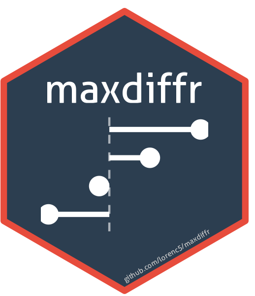

# maxdiffr 

<!-- badges: start -->
[](https://github.com/lorenc5/maxdiffr/actions/workflows/R-CMD-check.yaml)
[](https://github.com/lorenc5/maxdiffr/actions/workflows/style.yaml)
<!-- badges: end -->

A complete pipeline for **MaxDiff (Best-Worst Scaling)** survey analysis in R.

## Background: MaxDiff and Best-Worst Scaling

### What is MaxDiff?

MaxDiff (Maximum Difference Scaling), also known as **Best-Worst Scaling (BWS)**, is a survey-based method for measuring the relative importance or preference of a set of items. Respondents see subsets of items on successive screens and, for each screen, choose the **best** (most important/preferred) and **worst** (least important/preferred) item. This forced-choice design avoids common survey pitfalls like scale-use bias --- respondents cannot simply rate everything as "very important."

Each best-worst choice reveals the maximum perceptual difference in the respondent's mind, providing stronger signal per question than a standard Likert rating. With enough screens, every item appears an equal number of times, so each item is evaluated on a level playing field.

### Balanced Incomplete Block Designs (BIBD)

A MaxDiff survey relies on a **balanced incomplete block design (BIBD)** to determine which items appear on each screen. In a BIBD:

- There are *b* blocks (screens) and *v* items total.
- Each block shows *k* items (where *k* < *v*).
- Every item appears the same number of times across all blocks.
- Every pair of items appears together the same number of times.

This balance ensures that comparisons between items are equally informed by the data. For example, with 8 items and 4 items per screen, a BIBD with 8 blocks can be constructed where each item appears exactly 4 times and each pair co-occurs exactly once. `maxdiffr` wraps the `ibd` package to generate these designs automatically.

When a study has many respondents, **multiple design versions** can be used: each version uses a different randomized mapping of items to blocks, so that any residual order or position effects are averaged out across the sample.

### How It Works in Practice

A typical MaxDiff project follows this workflow:

1. **Researcher creates a design** specifying items, blocks, and versions.
2. **Survey company programs the instrument** using the design file, which maps item numbers to screen positions.
3. **Respondents complete the survey**, seeing one screen at a time.
4. **Data is exported** (e.g., as an SPSS `.sav` file) with one row per respondent and columns encoding their best/worst choices per screen.
5. **Analyst runs the pipeline** (validate, prep, aggregate, individual scoring, optionally anchor and TURF).

### Example Survey Screen

Imagine a study measuring which policy messages resonate most. The design file assigns items 2, 5, 3, and 7 to Screen 1 for Version 1. The survey platform renders:

> **Screen 1 of 8**
>
> Please review the following statements. Select the one you find **MOST important** and the one you find **LEAST important**.
>
> | Least Important |  Statement                                      | Most Important |
> |:---:|:--------------------------------------------------|:---:|
> |  O  | Lower energy costs for families                 |  O  |
> |  O  | Protect public lands and national parks          |  O  |
> |  O  | Invest in clean energy jobs                      |  O  |
> |  O  | Reduce dependence on foreign oil                 |  O  |

The respondent selects one radio button in the "Least Important" column and one in the "Most Important" column.

### The Anchor Question

Standard MaxDiff produces **relative** scores --- you learn that item A is preferred over item B, but not whether respondents actually care about either. **Anchored MaxDiff** adds an absolute reference point with a follow-up question after each screen:

> **Thinking about ALL of the statements you just saw on this screen, would you say...**
>
> - ( ) **ALL** of them are important to me
> - ( ) **SOME** of them are important to me
> - ( ) **NONE** of them are important to me

This response is coded as a pseudo-item called ANCHOR. If a respondent says ALL are important, the anchor is treated as *worse* than the shown items (anchor = -1 in the BW coding). If NONE are important, the anchor is *better* than the shown items (anchor = 1). SOME places the anchor in the middle (anchor = 0). After estimation, all item scores are rescaled relative to the anchor = 100 on a 100-point scale. Items scoring above 100 are genuinely valued; items below 100 are not.

This counts-based coding is one of several. Model-based alternatives treat the anchor as a threshold with utility fixed at zero: a conditional logit for the aggregate, and a hierarchical Bayes model in Stan for respondent-level results. See [Step 5b](#step-5b-model-based-anchoring-and-hierarchical-bayes).

## Installation

```r
# Install from GitHub
devtools::install_github("lorenc5/maxdiffr")
```

## Overview

`maxdiffr` provides a complete pipeline for MaxDiff (Best-Worst Scaling) survey analysis. The package includes simulated data so you can follow along immediately.

The pipeline has six stages:

1. **Design** --- Generate a BIBD design for the survey
2. **Validate** --- Check that survey responses match the design
3. **Prep** --- Convert raw survey data to long-format BW data
4. **Analyze** --- Aggregate and individual-level scoring
5. **Anchor** --- Absolute scale via counts, conditional logit, or hierarchical Bayes (optional)
6. **TURF** --- Portfolio optimization

## Load the Package and Data

```r
library(maxdiffr)
library(dplyr)

data(md_survey)   # 150 simulated respondents
data(md_design)   # IBD design: 8 items, 8 blocks, 4 items/block, 2 versions
data(md_items)    # Item labels
```

The simulated survey has 150 respondents across 2 design versions. Each respondent sees 8 screens with 4 items each, and picks a best and worst on each screen. An anchor question follows each screen.

## Step 1: Design Generation

If you need to create a new design from scratch, use `md_make_design()`. This wraps `ibd::ibd()` to produce a balanced incomplete block design with per-version randomization.

```r
new_des <- md_make_design(
  n_items = 8, n_blocks = 8, items_per_block = 4,
  n_respondents = 200, n_versions = 2,
  seeds = c(111, 222),
  item_labels = md_items$item_label
)
head(new_des)
```

The design file tells the survey platform which items to show on each screen. Each item appears the same number of times across blocks (balanced), so every item gets equal exposure.

## Step 2: Validate Responses

Before analysis, check that every respondent's best/worst picks are consistent with the items shown on their screen.

```r
val <- md_validate(
  md_survey, md_design,
  id_col = "id", version_col = "version",
  best_prefix = "QMAXDIFF_", best_suffix = "b",
  worst_prefix = "QMAXDIFF_", worst_suffix = "w",
  n_blocks = 8, n_items = 8, items_per_block = 4
)
```

`md_validate()` checks that:

- Best and worst are not NA
- Both are in the item range (1--8)
- Best != worst
- Both are in the set of items shown on that screen (per the design)

If `drop_invalid = TRUE`, it removes respondents with any issues.

## Step 3: Prep Data

`md_prep()` converts the raw survey columns (`QMAXDIFF_1b`, `QMAXDIFF_1w`, etc.) into a long-format data frame suitable for analysis. This is where the package saves the most work --- it replaces what was previously a manual, block-by-block recoding step.

```r
prep <- md_prep(
  md_survey, md_design,
  id_col = "id", version_col = "version",
  best_prefix = "QMAXDIFF_", best_suffix = "b",
  worst_prefix = "QMAXDIFF_", worst_suffix = "w",
  n_blocks = 8, n_items = 8, items_per_block = 4,
  item_labels = md_items$item_label
)

head(prep$long)
```

Each row in the long data represents one item shown to one respondent in one block. The `y` column encodes:

- `1` = chosen as best
- `-1` = chosen as worst
- `0` = shown but not chosen

Items not shown in a given block are excluded (not coded as 0 --- they simply don't appear).

## Step 4a: Aggregate Analysis

`md_aggregate()` computes best/worst counts per item and fits the **Analytical Estimation Multinomial Logit (AE-MNL)** model. This is a closed-form estimator for MaxDiff data that avoids iterative MLE.

### The AE-MNL Model

The beta coefficient for each item $i$ is the log-ratio of best to worst counts:

$$\beta_i = \ln\left(\frac{B_i}{W_i}\right)$$

where $B_i$ and $W_i$ are the number of times item $i$ was chosen as best and worst, respectively. A continuity correction of 0.5 is applied when either count is zero.

The standard error is:

$$\text{SE}_i = \sqrt{\frac{1}{B_i} + \frac{1}{W_i}}$$

Betas are converted to choice probabilities via the **softmax** function, which gives the probability that item $i$ would be chosen as best if all items were shown simultaneously:

$$P_i = \frac{e^{\beta_i}}{\sum_{k=1}^{K} e^{\beta_k}}$$

where $K$ is the total number of items. These probabilities sum to 1 across all items. A normalized best-worst score is also computed:

$$\text{NBW}_i = \frac{B_i - W_i}{N_i}$$

where $N_i$ is the total number of times item $i$ was shown.

```r
agg <- md_aggregate(
  prep$long,
  id_col = "pid", item_col = "message", response_col = "y"
)
agg |> select(message, bests, worsts, nbw, b, choice_p)
```

**Interpreting the output:**

- `nbw` --- normalized best-worst score; ranges from -1 to +1
- `b` --- AE-MNL beta; log-odds scale, centered at 0
- `choice_p` --- softmax probability; sums to 1 across all items

```r
md_plot_beta(agg, title = "Aggregate MaxDiff Results")
```

## Step 4b: Individual-Level Scoring

`md_ebayes()` computes individual-level scores using empirical Bayes shrinkage. Each respondent gets a score per item, pulled toward the aggregate to stabilize estimates from sparse per-person data.

```r
eb_long <- md_ebayes(
  prep$long,
  id_col = "pid", block_col = "block",
  item_col = "message", response_col = "y"
)
head(eb_long)

# Wide format: one row per respondent, one column per item
eb_wide <- md_ebayes(
  prep$long,
  id_col = "pid", block_col = "block",
  item_col = "message", response_col = "y",
  wide = TRUE
)
eb_wide |> select(1:5) |> head()
```

The `alpha` parameter controls shrinkage strength. Higher alpha pulls individual scores more toward the aggregate (default 0.1).

## Step 5: Anchored MaxDiff

Standard MaxDiff produces **relative** scores --- you know item A beats item B, but not whether respondents actually like either one. Anchoring adds an absolute reference point.

After each screen, respondents answer: "Are ALL, SOME, or NONE of these important?" This gets coded as an ANCHOR pseudo-item in the data.

### Anchored Prep

Pass the `anchor_prefix` and `anchor_suffix` arguments to `md_prep()`:

```r
prep_anc <- md_prep(
  md_survey, md_design,
  id_col = "id", version_col = "version",
  best_prefix = "QMAXDIFF_", best_suffix = "b",
  worst_prefix = "QMAXDIFF_", worst_suffix = "w",
  n_blocks = 8, n_items = 8, items_per_block = 4,
  item_labels = md_items$item_label,
  anchor_prefix = "QMAXDIFF_",
  anchor_suffix = "_anchor"
)

# ANCHOR now appears as an item
table(prep_anc$long$message)
```

### Anchored Aggregate + 100-Point Scale

```r
agg_anc <- md_aggregate(
  prep_anc$long,
  id_col = "pid", item_col = "message", response_col = "y"
)

a100 <- md_anchor_100(agg_anc, anchor_label = "ANCHOR")
a100 |> arrange(desc(thresh100)) |> select(message, thresh100, cut)
```

The ANCHOR item is always 100. Items above 100 are considered genuinely important by respondents; items below 100 are not.

```r
md_plot_anchor(a100, sample_label = "Simulated Data")
```

### Individual Anchored Scores

```r
eb_anc <- md_ebayes(
  prep_anc$long,
  id_col = "pid", block_col = "block",
  item_col = "message", response_col = "y",
  skip_checks = TRUE  # required for anchored data
)

ind_a100 <- md_ind_anchor_100(eb_anc, id_col = "pid", item_col = "message")
ind_a100 |> select(1:5) |> head()
```

## Step 5b: Model-Based Anchoring and Hierarchical Bayes

The counts-based anchoring in Step 5 is quick, but how the ALL and NONE screens are coded matters a lot. The default `md_prep()` coding (`anchor_coding = "drop_choices"`) throws away the respondent's best and worst picks on those screens. `maxdiffr` offers three more defensible alternatives, from simplest to richest.

### Option A: keep the picks on ALL/NONE screens (counts)

```r
prep_keep <- md_prep(
  md_survey, md_design,
  id_col = "id", version_col = "version",
  n_blocks = 8, n_items = 8, items_per_block = 4,
  item_labels = md_items$item_label,
  anchor_prefix = "QMAXDIFF_", anchor_suffix = "_anchor",
  anchor_coding = "keep_choices"  # ALL keeps best; NONE keeps worst
)
agg_keep <- md_aggregate(prep_keep$long, id_col = "pid", item_col = "message", response_col = "y")
md_anchor_100(agg_keep)
```

### Option B: conditional logit with the threshold fixed at zero

`md_screens()` builds a respondent x screen table (items shown, best, worst, anchor answer). `md_anchor_logit()` then fits a pooled conditional logit in which the anchor is a "threshold" alternative with utility fixed at 0. Standard errors are clustered by respondent.

```r
scr <- md_screens(
  md_survey, md_design,
  id_col = "id", version_col = "version",
  n_blocks = 8, n_items = 8, items_per_block = 4,
  item_labels = md_items$item_label,
  anchor_prefix = "QMAXDIFF_", anchor_suffix = "_anchor"
)

md_anchor_logit(scr)                              # implied_pairs coding (default)
md_anchor_logit(scr, coding = "dual_response")    # threshold as an extra alternative
md_anchor_logit(scr, ids = md_survey$id[md_survey$QPARTYID <= 2])  # a subgroup
```

`score100 = 100 x exp(b)`: 100 means the average respondent is as likely as not to put the message above their threshold.

The two codings (see `?md_anchor_tasks`) are:

| Coding | ALL screen | SOME screen | NONE screen |
|---|---|---|---|
| `implied_pairs` | best & worst among the 4, plus each item beats the threshold | best & worst, plus best beats threshold and threshold beats worst | best & worst, plus the threshold beats each item |
| `dual_response` | threshold added as a 5th alternative; best = original best, worst = threshold | best & worst among all 5 | best = threshold, worst = original worst |

### Option C: hierarchical Bayes (individual-level)

`md_hb()` fits a hierarchical Bayes multinomial logit on the same coded tasks, giving **every respondent their own utility for each message relative to their own threshold**. Respondent utilities come from a multivariate normal population (mean `mu`, scales `tau`, LKJ(2) correlation prior, non-centered parameterization).

### The HB Anchored Model

Let $\beta_{nj}$ be respondent $n$'s utility for message $j$, measured relative to their own threshold, which is fixed at zero ($\beta_{n0} = 0$). On a screen showing the set $S$, the best and worst picks follow a multinomial logit:

$$P(\text{best} = j \mid S) = \frac{e^{\beta_{nj}}}{\sum_{k \in S} e^{\beta_{nk}}}, \qquad P(\text{worst} = j \mid S) = \frac{e^{-\beta_{nj}}}{\sum_{k \in S} e^{-\beta_{nk}}}$$

Under `implied_pairs` coding, each message-vs-threshold comparison that the anchor answer implies adds a binary logit term:

$$P(\text{message } j \text{ beats the threshold}) = \frac{e^{\beta_{nj}}}{1 + e^{\beta_{nj}}}$$

Under `dual_response` coding, the threshold (utility 0) simply joins $S$ as an extra alternative. Respondent utilities share a multivariate normal population distribution:

$$\boldsymbol{\beta}_n \sim \text{MVN}\left(\boldsymbol{\mu},\ \text{diag}(\boldsymbol{\tau})\ \boldsymbol{\Omega}\ \text{diag}(\boldsymbol{\tau})\right)$$

with priors

$$\mu_j \sim N(0, 2^2), \qquad \tau_j \sim N^{+}(0, 1.5^2), \qquad \boldsymbol{\Omega} \sim \text{LKJ}(2)$$

The model is fit with a non-centered parameterization, where $\mathbf{L}$ is the Cholesky factor of $\boldsymbol{\Omega}$:

$$\boldsymbol{\beta}_n = \boldsymbol{\mu} + \text{diag}(\boldsymbol{\tau})\ \mathbf{L}\ \mathbf{z}_n, \qquad \mathbf{z}_n \sim N(\mathbf{0}, \mathbf{I})$$

Over posterior draws $d = 1, \dots, D$, the share of respondents a message moves (`pct_above`) and the anchored TURF reach of a message set $M$ are:

$$\text{PctAbove}_j = \frac{100}{D} \sum_{d=1}^{D} \frac{1}{N} \sum_{n=1}^{N} \mathbb{1}\left[\beta_{nj}^{(d)} \gt 0\right], \qquad \text{Reach}(M) = \frac{100}{N} \sum_{n=1}^{N} \left[ 1 - \prod_{j \in M} \left(1 - p_{nj}\right) \right]$$

where

$$p_{nj} = \frac{1}{D}\sum_{d=1}^{D} \mathbb{1}\left[\beta_{nj}^{(d)} \gt 0\right]$$

is the posterior probability that message $j$ clears respondent $n$'s threshold.


```r
hb <- md_hb(scr, chains = 4, iter = 1500, cores = 4)   # needs rstan
hb                                                     # R-hat, n_eff, divergences

# % of respondents for whom each message clears their own threshold,
# with posterior intervals; optional subgroups compared with everyone else
groups <- list(
  overall = md_survey$id,
  dem     = md_survey$id[md_survey$QPARTYID <= 2]
)
md_hb_summary(hb, groups = groups)

md_hb_scores(hb)             # respondent x message utilities and P(above threshold)
md_hb_turf(hb, combo = 1:3)  # anchored TURF; attr(, "ceiling") = reach of all messages
```

`md_hb_summary()` reports two quantities:

- **`pct_above`**: the share of respondents for whom the message is above their own threshold. This is usually the most robust anchored number. It changes little across codings, and it describes the sample directly even when respondents split into "moved by everything" and "moved by nothing" camps.
- **`typical`**: 100 x exp(mean utility), the threshold score of the average respondent.

`md_hb_turf()` counts a respondent as reached if **at least one** message in the set clears their threshold. This is persuasion reach, not "top message" reach.

**How it runs.** The model is written in [Stan](https://mc-stan.org) and ships in `inst/stan/hb_mnl_anchor.stan`. There is no hand-written C++ or Rcpp. `rstan` translates the Stan program into C++, compiles it the first time `md_hb()` is called in a session (about a minute; it is cached afterwards), and runs the No-U-Turn sampler as native code. R only builds the data (`md_hb_data()`) and summarizes the draws. `rstan` is a suggested dependency, so the rest of the package installs without a C++ toolchain. To use `cmdstanr` instead, pass `md_hb_data(scr)$data` to the same `.stan` file.

As a rough guide, 800 respondents x 12 screens x 12 messages takes about 15 minutes with 4 chains of 1,500 iterations.

### How robust are anchored results? `md_anchor_patterns()`

```r
pat <- md_anchor_patterns(scr)
pat$screens      # % of screens answered ALL / SOME / NONE
pat$patterns     # % of respondents answering NONE (or ALL, or SOME) on every screen
pat$exposure     # per message: % of exposures clearly moved / not moved / undetermined
```

If a large share of respondents answer NONE on every screen, the threshold reflects fixed dispositions more than the messages. Anchored levels then depend on modeling choices, while the ranking of messages stays stable. Report anchored results with that caveat.

## Step 6: TURF Analysis

TURF (Total Unduplicated Reach and Frequency) answers: "If I can only use N messages, which combination reaches the most people?"

```r
# Build binary matrix: 1 = this item is the respondent's top-scoring item
turf <- md_turf_matrix(eb_wide, id_col = "pid")

# Single item reach
md_portfolio(turf, combo = 1, id_col = "pid")

# Best pairs
md_portfolio(turf, combo = 2, id_col = "pid", top_n = 5)

# Best trios
md_portfolio(turf, combo = 3, id_col = "pid", top_n = 5)
```

```r
md_plot_turf(turf, id_col = "pid", title = "Cumulative Reach")
```

## Subgroup Comparison

`md_subgroup()` runs the full pipeline for each subgroup and returns
side-by-side results. First create a reusable configuration with
`md_prep_config()`:

```r
config <- md_prep_config(
  design_df = md_design,
  id_col = "id", version_col = "version",
  best_prefix = "QMAXDIFF_", best_suffix = "b",
  worst_prefix = "QMAXDIFF_", worst_suffix = "w",
  n_blocks = 8, n_items = 8, items_per_block = 4,
  item_labels = md_items$item_label,
  anchor_prefix = "QMAXDIFF_",
  anchor_suffix = "_anchor",
  weight_col = "weight"
)

results <- md_subgroup(
  md_survey, config,
  group_col = "QPARTYID",
  groups = list(Democrat = 1:2, Independent = 3:5, Republican = 6:7),
  turf = TRUE, turf_combo = 2, turf_top_n = 5
)

results                  # print summary
results$wide$aggregate   # side-by-side betas and choice probabilities
results$wide$anchor      # side-by-side anchored 100-point scores
results$aggregate        # long format for ggplot
results$turf             # TURF portfolios by subgroup
results$n_per_group      # sample sizes
```

## Weighted Analysis

The simulated data includes a `weight` column (raked survey weights centered near 1). Pass `weight_col` to `md_prep()` so the weight is carried into the long data, then reference it in downstream functions:

```r
# Prep with weight
prep_w <- md_prep(
  md_survey, md_design,
  id_col = "id", version_col = "version",
  best_prefix = "QMAXDIFF_", best_suffix = "b",
  worst_prefix = "QMAXDIFF_", worst_suffix = "w",
  n_blocks = 8, n_items = 8, items_per_block = 4,
  item_labels = md_items$item_label,
  weight_col = "weight"
)

# Weighted aggregate
agg_w <- md_aggregate(prep_w$long, id_col = "pid", item_col = "message",
                      response_col = "y", weight_col = "weight")

# Weighted individual scores
eb_w <- md_ebayes(prep_w$long, id_col = "pid", block_col = "block",
                  item_col = "message", response_col = "y",
                  weight_col = "weight", wide = TRUE)
```

## Function Reference

| Step | Function | What it does |
|------|----------|-------------|
| Design | `md_make_design()` | Generate IBD survey design |
| Validate | `md_validate()` | Check responses against design |
| Prep | `md_prep()` | Raw survey to long-format BW data |
| Prep | `md_prep_config()` | Reusable config for `md_prep()` parameters |
| Aggregate | `md_aggregate()` | Item-level betas + choice probabilities |
| Individual | `md_ebayes()` | Per-respondent empirical Bayes scores |
| Anchor | `md_anchor_100()` | Absolute 100-point scale (aggregate) |
| Anchor | `md_ind_anchor_100()` | Absolute 100-point scale (individual) |
| Anchor | `md_screens()` | Respondent x screen table (shown items, picks, anchor) |
| Anchor | `md_anchor_tasks()` | Code screens as `implied_pairs` or `dual_response` tasks |
| Anchor | `md_anchor_logit()` | Conditional logit, threshold fixed at 0, clustered SEs |
| Anchor | `md_anchor_patterns()` | Who moves: anchor answer patterns and per-message exposure |
| HB | `md_hb()` | Hierarchical Bayes anchored MNL (Stan via rstan) |
| HB | `md_hb_data()` | Stan data list (for fitting with cmdstanr etc.) |
| HB | `md_hb_summary()` | % above own threshold + typical score, by subgroup |
| HB | `md_hb_scores()` | Respondent-level utilities and P(above threshold) |
| HB | `md_hb_turf()` | Anchored TURF (reach = at least one message clears threshold) |
| Subgroup | `md_subgroup()` | Side-by-side comparison across subgroups |
| TURF | `md_turf_matrix()` | Binary reach matrix |
| TURF | `md_portfolio()` | Portfolio optimization |
| Plot | `md_plot_beta()` | Beta dot-and-whisker |
| Plot | `md_plot_anchor()` | Anchored score dot plot |
| Plot | `md_plot_turf()` | Cumulative reach curve |

## License

MIT
